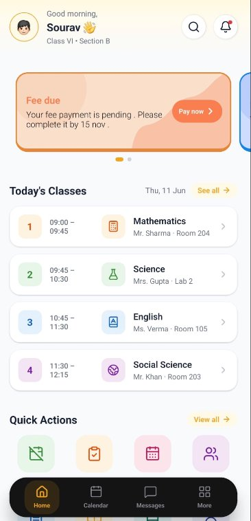
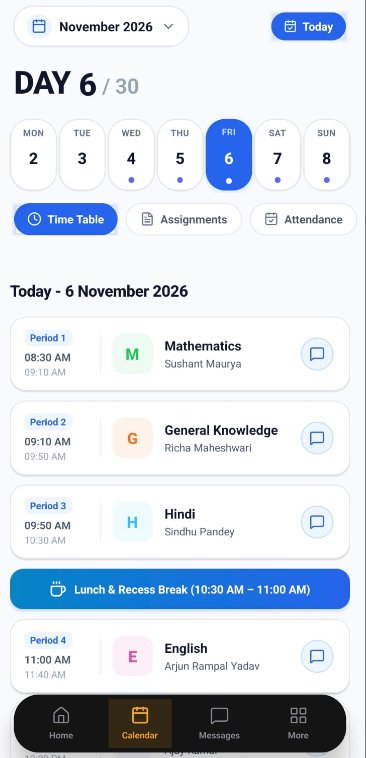
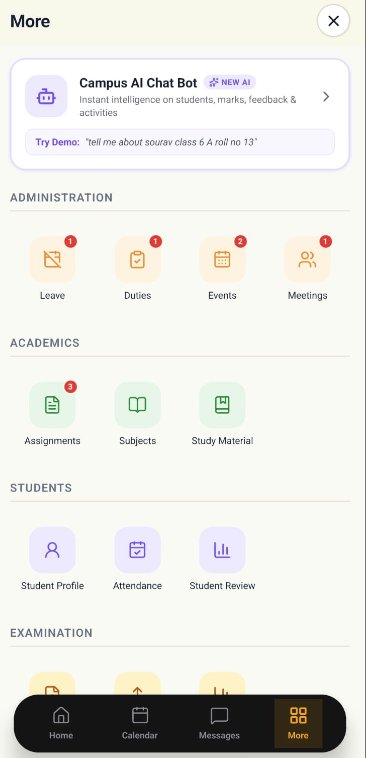
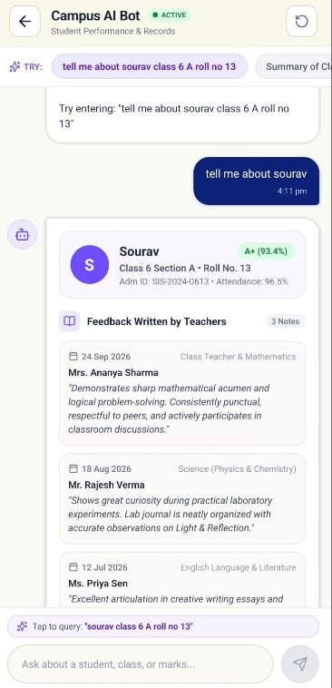

# Operia Campus

A cross-platform campus management mobile app built with **React Native**, **Expo SDK 54**, and **TypeScript**. Operia Campus provides a unified interface for students and faculty to manage academics, attendance, timetables, messaging, and more all from a single app.

## Screenshots

<p align="center">
  
  &nbsp;&nbsp;
  
  &nbsp;&nbsp;
  
  &nbsp;&nbsp;
  
</p>

<p align="center">
  <em>Dashboard • Calendar & Timetable • All Modules • AI Campus Bot</em>
</p>

## Features

### Dashboard

- Personalized greeting with class & section info
- Snappable banner carousel with SVG decorative waves and pagination dots
- Today's timetable at a glance with period cards
- Quick action grid for fast navigation
- Upcoming events, assignments, and announcements

### Calendar & Timetable

- Weekly day-pill selector with completion indicators and haptic feedback
- Category-filtered views — Timetable, Assignments, Attendance
- Period cards with teacher info and chat links
- Animated sliding number counter for day tracking
- Full dark-mode theming support

### Faculty Messaging

- Direct messaging with course teachers
- Category filter pills (Subject, Role, Unread)
- Online/offline status with pulse animation
- File attachment support (PDF, Doc, Image)
- Quick reply suggestions based on subject context
- Voice/video call simulation UI

### AI Campus Bot

- Natural language queries for student performance and records
- Student profile cards with grades, attendance, and admin ID
- Teacher feedback timeline with subject-tagged notes
- Suggested prompt chips for quick exploration

### 20+ Feature Modules

| Category           | Modules                                                                        |
| ------------------ | ------------------------------------------------------------------------------ |
| **Administration** | Leave Requests, Duties, Events, Meetings, Notifications                        |
| **Academics**      | Assignments, Subjects, Study Material, Library                                 |
| **Students**       | Student Profile, Mark Attendance, Student Review                               |
| **Examination**    | Create Exam, Upload Marks, Results, Generate Report                            |
| **Timetable**      | My Timetable, View Timetable, Manage Timetable, Class Routine, Room Allocation |

## Tech Stack

| Layer          | Technology                                               |
| -------------- | -------------------------------------------------------- |
| **Framework**  | React Native 0.86 + Expo SDK 54                          |
| **Language**   | TypeScript                                               |
| **Navigation** | Expo Router (file-based routing with typed routes)       |
| **Animations** | React Native Reanimated 4.5 + Animated API               |
| **Gestures**   | React Native Gesture Handler                             |
| **UI**         | Lucide Icons, Expo Linear Gradient, React Native SVG     |
| **Calendar**   | React Native Calendars (WeekCalendar + CalendarProvider) |
| **Haptics**    | Expo Haptics                                             |
| **Fonts**      | Google Fonts (Roboto, DM Sans)                           |

## UI Highlights

- **Custom Animated Tab Bar** — Spring-driven scroll-to-hide with directional delta thresholds using Reanimated shared values and Context API
- **Sliding Digit Animations** — Per-digit spring transitions with dynamic layout measurement for smooth number counters
- **Banner Carousel** — Snap-to-interval horizontal scroll with SVG wave decorations and auto-pagination
- **Gradient Hero Header** — Multi-stop linear gradient header with safe area awareness
- **Haptic Feedback** — Contextual haptic responses throughout interactions (Light, Medium, Success, Warning)

## Getting Started

### Prerequisites

- [Node.js](https://nodejs.org/) (v18+)
- [Expo CLI](https://docs.expo.dev/get-started/installation/)
- Android emulator / iOS simulator / Physical device with [Expo Go](https://expo.dev/go)

### Installation

```bash
# Clone the repository
git clone https://github.com/sourav-jyoti/OperiaCampusApp.git
cd OperiaCampusApp

# Install dependencies
npm install

# Start the development server
npx expo start
```

In the output, you'll find options to open the app in a:

- [Development build](https://docs.expo.dev/develop/development-builds/introduction/)
- [Android emulator](https://docs.expo.dev/workflow/android-studio-emulator/)
- [iOS simulator](https://docs.expo.dev/workflow/ios-simulator/)
- [Expo Go](https://expo.dev/go)

## Project Structure

```
src/
├── app/
│   ├── (auth)/          # Login & authentication screens
│   ├── (app)/
│   │   ├── (tabs)/      # Main tab screens (Dashboard, Calendar, Messages, More)
│   │   └── profile/     # User profile
│   └── (Tiles)/         # 20+ feature module screens
├── components/
│   ├── animated/        # Sliding digit & number animations
│   ├── calendar/        # Calendar agenda, day selector, category tabs
│   └── ...              # Alert cards, custom tab bar, event cards
├── context/             # Tab bar visibility context & scroll hook
├── hooks/               # Custom hooks (useTabBarScroll)
├── styles/              # Shared stylesheets
└── utilities/           # Types, mock data
```

## License

This project is open source and available under the [MIT License](LICENSE).
